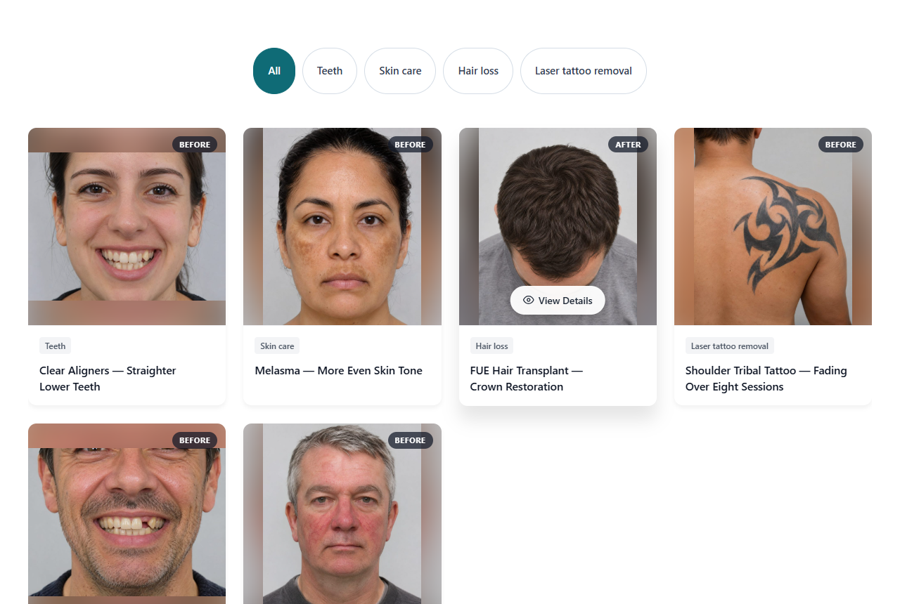
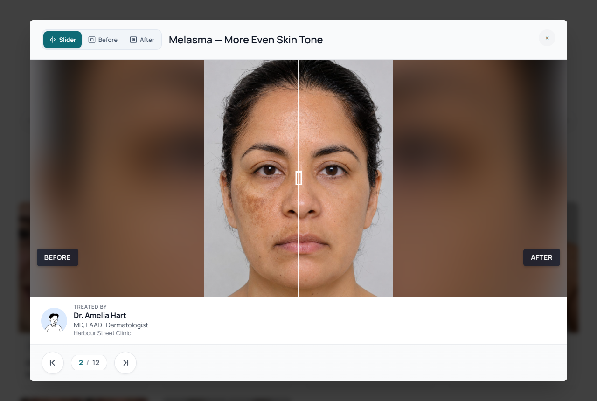
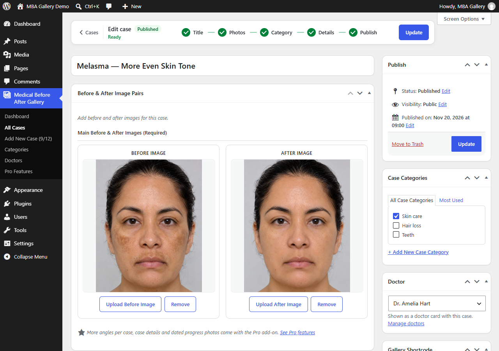

# Medical Before After Gallery (MBA Gallery)

A WordPress plugin for before-and-after case galleries. A practice adds its cases (a before photo, an after
photo, a title, a category and, optionally, the doctor) and puts the shortcode `[medbeafgallery]` on a page.
Visitors browse by category and open each case in a case window with a draggable before/after slider.

It is made for practices that show treatment results: plastic and cosmetic surgery, dermatology, dentistry and
orthodontics, hair restoration, aesthetic medicine and weight-loss clinics.

This repository holds the free plugin. The paid Pro add-on is a separate plugin and is not in this repository.

## Links

- **Download:** [Medical Before After Gallery on WordPress.org](https://wordpress.org/plugins/medical-before-after-gallery/)
- **Website:** [medicalbeforeaftergallery.com](https://medicalbeforeaftergallery.com/)
- **Demo:** [every demo, Pro and free](https://medicalbeforeaftergallery.com/demo/), or straight to the
  [free plugin's demo](https://demo.medicalbeforeaftergallery.com/free/)
- **Documentation:** [medicalbeforeaftergallery.com/docs](https://medicalbeforeaftergallery.com/docs/)
- **Support:** [medicalbeforeaftergallery.com#support](https://medicalbeforeaftergallery.com#support)

## Screenshots

The gallery with hover-reveal cards:



The case window:



Editing a case:



## Features of the free plugin

- **Comparison slider:** drag to compare, or switch to the before-only or after-only view.
- **Two card styles:** before and after side by side, or hover reveal (the before photo wipes to the after photo
  on hover, keyboard focus, or a press-and-hold on phones).
- **Blurred photo background** in the case window instead of black bars (can be turned off).
- **Doctors:** photo, credentials, location and profile link; the case window shows a doctor card.
- **Categories** with parents and subcategories, in four styles: image carousel, image grid, buttons or a
  drop-down menu.
- **Cases screen:** search, filter and sort; publish, unpublish, trash or restore one case or several at once.
- **Categories and Doctors screens:** add, edit, delete and drag into order; categories can be nested.
- **Image cropping** to bring before and after photos to the same size. Cropping saves a new copy; the original
  photo is not changed.
- **Colours:** a solid colour or a gradient.
- **Accessibility:** keyboard navigation, screen-reader labels, focus kept inside the case window and returned
  afterwards, and no animation for visitors who ask for reduced motion.
- **Touch:** cards, slider and case window work on phones and tablets.
- **Privacy:** photos stay in the site's Media Library, and the gallery sends nothing to third parties.
- **Your data:** deleting the plugin keeps your cases unless you choose otherwise in the settings.

## Shortcode

```text
[medbeafgallery]
[medbeafgallery items_per_page="9" default_category="face" category_style="buttons" card_style="reveal"]
```

| Attribute | Values | Default |
|---|---|---|
| `items_per_page` | Number of cards shown before "Load More" | `6` |
| `default_category` | Slug of the category the gallery opens on, or `all` | `all` |
| `category_style` | `carousel`, `grid`, `buttons`, `dropdown` | The Category Navigation setting |
| `card_style` | `split` (side by side) or `reveal` (hover reveal) | The Card Style setting |
| `show_filters` | `true`; `false`, `0`, `no` or `off` hides the category bar | `true` |

It works wherever WordPress runs shortcodes: the block editor's Shortcode block, the classic editor, and the
shortcode or text modules of page builders.

## Install

1. In WordPress, go to **Plugins → Add New**, search for "Medical Before After Gallery", then install and
   activate it.
2. Open **Medical Before After Gallery** in the admin menu and choose your settings.
3. Add your categories and your first case (and, optionally, your doctors).
4. Put `[medbeafgallery]` on any page or post.

For production sites, use the WordPress.org version or the ZIP attached to a GitHub release. GitHub's
"Download ZIP" button gives the development files, and unpacks to a different folder name.

### Requirements

- WordPress 5.0 or later (tested up to 7.1)
- PHP 7.4 or later

### Limits of the free plugin

- 12 cases
- 4 categories (the built-in "All" does not count)
- One before/after photo pair per case

## Pro add-on

The optional [Pro add-on](https://medicalbeforeaftergallery.com/) removes these limits and adds, among other
things, case filters and search, more layouts, category styles and case-window styles, progress timelines with
dated photos, a single-case embed, watermarks and a sensitive-content notice. It needs this plugin to run.

## Development

There is no build step: the repository is the plugin's PHP, CSS and JavaScript as shipped.

| Path | Contents |
|---|---|
| `medical-before-after-gallery.php` | Plugin header, constants, requirements check, asset loading |
| `includes/` | Post type and taxonomies, shortcode, REST endpoints, doctors, helpers |
| `admin/` | Dashboard and settings, case editor, and the cases, categories and doctors screens |
| `assets/` | Front-end CSS and JavaScript, images, bundled libraries |
| `.wordpress-org/` | Banner, icons and screenshots for the WordPress.org page |

Work on a branch and open a pull request against `main`. CI (`.github/workflows/ci.yml`) runs on every push and
pull request:

- `bash bin/check-release.sh`: the plugin header, `MEDBEAFGALLERY_VERSION` and the readme's stable tag agree,
  the changelog has an entry for that version, and the release build contains the right files;
- `php -l` on PHP 7.4 to 8.4;
- `node --check` on the plugin's own scripts.

To run the checks locally:

```bash
bash bin/check-release.sh
find . -name '*.php' -print0 | xargs -0 -n1 php -l
find assets/js admin/js -name '*.js' -print0 | xargs -0 -n1 node --check
```

### Merging a version bump into `main` releases the plugin

`.github/workflows/deploy.yml` runs on every push to `main`. If the version in the plugin header is newer than
the one on WordPress.org and the checks pass, it **deploys that version to WordPress.org**, tags the commit and
creates a GitHub release with the ZIP. By default there is no manual step, so do not change the version in a
pull request unless it is meant to be released. A push that does not change the version deploys nothing.

Running that workflow by hand from the Actions tab is a dry run: it builds the ZIP and publishes nothing.

### Conventions

Prefix everything with `medbeafgallery_` (CSS: `medbeafgallery-`), indent with four spaces, keep to PHP 7.4
syntax, sanitize input, escape output, and check a nonce and a capability before every write.

Add-ons build on this plugin's hooks, functions, post meta and REST fields, so add new ones beside the old ones
instead of renaming or removing them.

## License and credits

GPLv2 or later; see [LICENSE.txt](LICENSE.txt).

Bundled libraries:

- [Cocoen](https://github.com/koenoe/cocoen), the before/after slider, MIT license
- [Cropper.js](https://github.com/fengyuanchen/cropperjs), used by the cropping tool in the admin, MIT license
